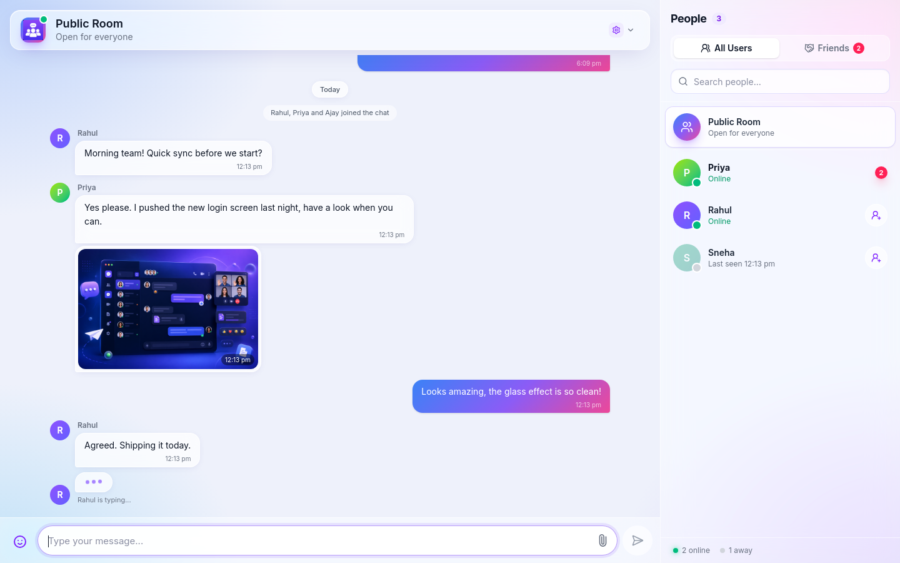
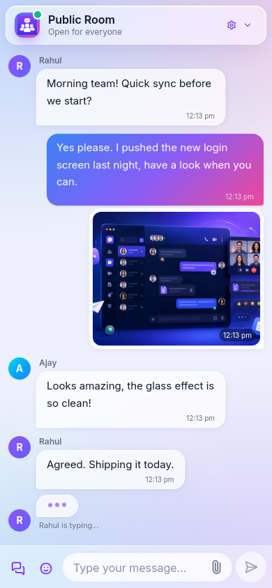
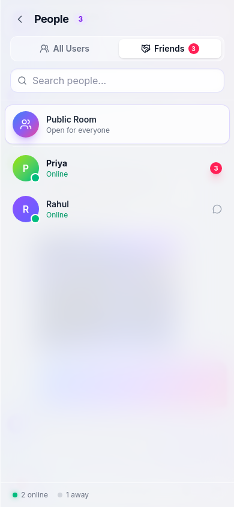
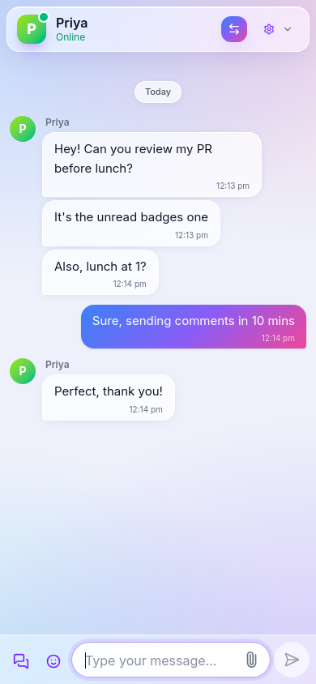
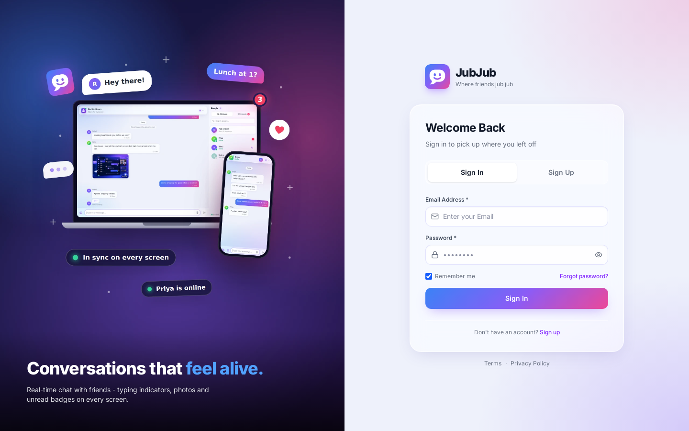
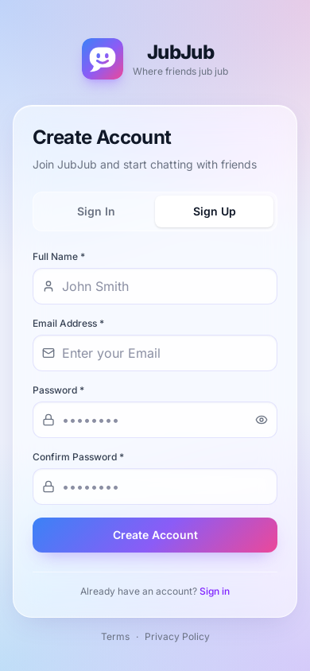
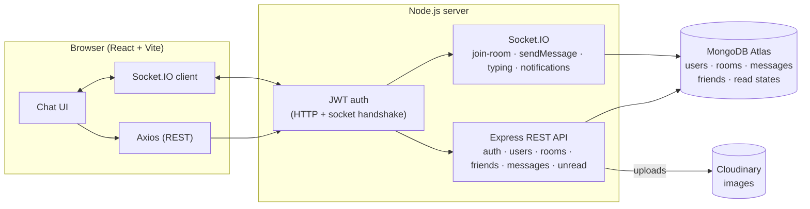

<div align="center">

# 💬 JubJub

**Where friends jub jub.** A real-time chat app with a public room, private chats, live typing, photos and unread badges, designed mobile-first with a frosted-glass UI.

[](https://talkmate-ezzq.onrender.com)




</div>

> The live demo runs on Render's free plan, so the first request after a while can take ~50 seconds while the server wakes up.

---

## 📱 Made for phones too

<table>
  <tr>
    <td align="center"><br /><sub><b>Group chat</b>: live typing, photos</sub></td>
    <td align="center"><br /><sub><b>People</b>: unread counts per friend</sub></td>
    <td align="center"><br /><sub><b>Private chat</b> with a friend</sub></td>
  </tr>
</table>

<table>
  <tr>
    <td align="center" width="68%"><br /><sub><b>Sign in</b> (desktop)</sub></td>
    <td align="center"><br /><sub><b>Sign up</b> (phone)</sub></td>
  </tr>
</table>

---

## ✨ Features

**Messaging**
- ⚡ **Real-time chat** over WebSockets (Socket.IO): a public room for everyone plus 1-to-1 private chats
- ✍️ **Typing indicator** that appears live and clears the moment the message is sent
- 📷 **Photos**: pick from your gallery or take one with the camera (the phone's own camera on mobile, an in-app webcam on desktop), uploaded to Cloudinary
- 😀 Emoji picker, multi-line messages (Enter to send, Shift+Enter for a new line)
- 🗓️ Date separators (*Today*, *Yesterday*, weekday) and "X, Y and Z joined the chat" grouping

**People & presence**
- 👥 Add friends, search people, online / *last seen* status updated live
- 🔴 **Unread badges** per chat, **even for messages that arrived while you were offline**. The server remembers what each user last read, so counts stay correct across reloads and devices.

**Built for mobile**
- 📐 Responsive from 360px phones to wide desktops; the people list becomes a slide-over panel on small screens
- ⌨️ The header stays visible and the input sits right above the **on-screen keyboard** (uses the `visualViewport` API)
- 🖐️ Feels native: no accidental pinch/double-tap zoom, no pull-to-refresh bounce, no tap flashes

**Security**
- 🔐 JWT authentication (7-day sessions) with a clean "session expired" sign-out
- 🛡️ Private chats are readable and writable **only by their participants**, both over REST and WebSockets
- 🪪 The sender of every message comes from the login token, so messages can't be sent under someone else's name
- 📤 Uploads require login; attachments must come from the app's own Cloudinary account
- 🔑 Passwords hashed with bcrypt; unique emails

---

## 🧱 Tech stack

| Layer | Technology |
|---|---|
| **Frontend** | React 18, Vite, Tailwind CSS 4, React Router 7, React Hook Form + Yup, Socket.IO client, Axios, Emoji Mart, Sonner (toasts), Lucide icons |
| **Backend** | Node.js, Express 5, Socket.IO, Mongoose, JSON Web Tokens, bcrypt, Multer |
| **Data & media** | MongoDB Atlas, Cloudinary |
| **Hosting** | Render (frontend + backend) |

---

## 🏗️ Architecture



**How a message travels**
1. The sender's browser emits `sendMessage` over the socket.
2. The server checks that the sender belongs to the room, takes their identity from the JWT, and saves the message in MongoDB.
3. It broadcasts the message to everyone currently in that room, and sends a small `message-notification` to everyone else who should see it (private: the other participant; public: everyone online). That's what drives the live unread badges.

**How unread counts survive being offline.** A `ReadState` document stores when each user last read each chat. On sign-in (and whenever the socket reconnects), the app asks `GET /api/room/unread`, which counts other people's messages newer than that time. Opening a chat calls `POST /api/room/:roomId/read`.

---

## 📁 Project structure

```
.
├── backend/
│   ├── app.js                  # Express app, CORS, routes
│   ├── server.js               # HTTP server + Socket.IO + MongoDB connection
│   └── src/
│       ├── config/             # MongoDB and Cloudinary setup
│       ├── features/           # one folder per feature: routes → controller → repository → schema
│       │   ├── user/           #   sign-up / sign-in / users list
│       │   ├── room/           #   public & private rooms, unread counts, read states
│       │   ├── friend/
│       │   ├── message/
│       │   └── cloudinaryupload/
│       ├── middlewares/        # JWT auth (HTTP + socket), uploads, error handler
│       ├── realTime/           # online / offline presence
│       └── socket/             # Socket.IO events
├── frontend/
│   ├── index.html
│   └── src/
│       ├── pages/              # Login, Chat, ChatHeader, MessageItem, MessageInput, OnlineUsers…
│       ├── components/         # routing, camera capture
│       ├── contexts/           # AuthProvider: session, current room, unread counts
│       ├── services/           # Axios client
│       ├── utils/              # session expiry, avatar colours, date formatting
│       └── index.css           # theme tokens (colours, glass, buttons)
└── docs/screenshots/
```

---

## 🚀 Getting started

### Prerequisites
- Node.js 20+
- A MongoDB database (local or a free [MongoDB Atlas](https://www.mongodb.com/atlas) cluster)
- A free [Cloudinary](https://cloudinary.com) account (for photo messages)

### 1. Clone
```bash
git clone https://github.com/prajapathiAjay/TalkMate.git
cd TalkMate
```

### 2. Backend
```bash
cd backend
npm install
```
Create `backend/.env` with **your own** values (placeholders shown):
```env
PORT=5000
MONGO_URI=<your-mongodb-connection-string>
JWT_SECRET=<a-long-random-secret>
JWT_EXPIRES_IN=7d
NODE_ENV=development

CLOUDINARY_CLOUD_NAME=<your-cloudinary-cloud-name>
CLOUDINARY_API_KEY=<your-cloudinary-api-key>
CLOUDINARY_API_SECRET=<your-cloudinary-api-secret>
```

> 🔒 Keep real credentials only in `.env` (it's git-ignored) and in your hosting provider's environment settings. Never commit them or paste them into issues or READMEs.
```bash
npm run dev        # starts on http://localhost:5000
```

### 3. Frontend
```bash
cd ../frontend
npm install
```
Create `frontend/.env`:
```env
VITE_API_URL=http://localhost:5000
VITE_APP_NAME=api
```
```bash
npm run dev        # opens on http://localhost:5173
```

The shared public room is created automatically the first time the backend starts.

> 📱 To try it on your phone, run `npm run dev -- --host` in `frontend/` and open the *Network* URL on the same Wi-Fi.

---

## 🔌 API overview

All endpoints except sign-up / sign-in need `Authorization: Bearer <token>`.

| Method | Endpoint | Description |
|---|---|---|
| `POST` | `/api/user/signUp` | Create an account (returns a token) |
| `POST` | `/api/user/signIn` | Sign in (returns a token) |
| `GET` | `/api/user/allUsers?name=&isOnline=` | List / search users |
| `POST` | `/api/room/createRoom` | Start a private chat with a user (`{ friendId }`) |
| `GET` | `/api/room/private?name=` | Your private chats, with the other person's details |
| `GET` | `/api/room/unread` | Unread counts per chat `{ roomId: count }` |
| `POST` | `/api/room/:roomId/read` | Mark a chat as read |
| `GET` | `/api/messages/getMessages?roomId=` | Messages of a room you belong to |
| `POST` | `/api/friend/add` | Add a friend |
| `GET` | `/api/friend/getFriends` | Your friends |
| `POST` | `/api/upload/messages` | Upload up to 3 images, 10 MB each (multipart `files`) |

**Socket.IO events** (the connection is authenticated with the JWT in `auth.token`)

| Direction | Event | Purpose |
|---|---|---|
| client → server | `join-room` | Open a chat (refused with `room-error` if you're not a member) |
| client → server | `sendMessage` | Send a message / photos (acknowledged) |
| client → server | `typing`, `stop-typing` | Typing indicator |
| server → client | `message` | New message in the open chat |
| server → client | `message-notification` | New message elsewhere → unread badge |
| server → client | `userTyping`, `userStopTyping` | Someone is typing |
| server → client | `user-status-changed` | Someone came online / went offline |

---

## ☁️ Deployment

The live version runs on **Render** (a *Web Service* for the backend and a *Static Site* for the frontend) with **MongoDB Atlas**.

- **Backend:** build `npm install`, start `npm start`, and set the environment variables above in Render.
- **Frontend:** build `npm install && npm run build`, publish `dist/`, set `VITE_API_URL` to the backend URL, and add a rewrite of `/*` → `/index.html` so routes like `/chat` work on refresh.
- **CORS:** the allowed frontend origin is set in `backend/app.js` and `backend/src/socket/socketLogic.js`. Update it if your frontend URL changes.
- **Atlas free tier:** clusters pause after ~60 days without connections. If the backend logs `querySrv ENOTFOUND`, resume the cluster in Atlas.

---

## 🗺️ Roadmap

- [ ] Read receipts (✓ / ✓✓)
- [ ] Message pagination (load older messages on scroll)
- [ ] Installable PWA with push notifications
- [ ] Reply / react to a message
- [ ] Group chats beyond the public room

---

## 👤 Author

**Ajay Prajapathi**: [GitHub @prajapathiAjay](https://github.com/prajapathiAjay)

If you like the project, a ⭐ on the repo is appreciated!
